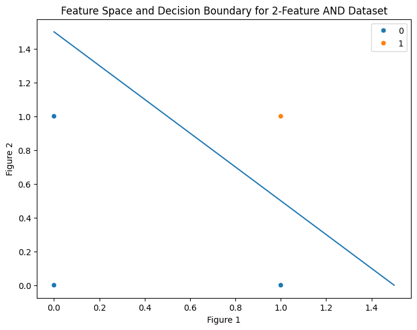
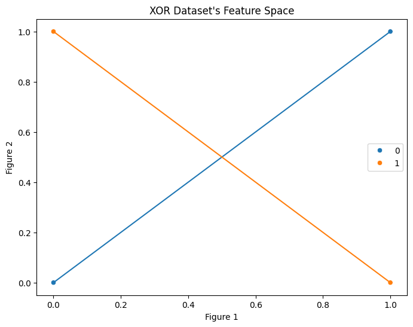

# Module 2 – Practice Questions (Answers)

## My Solution to Practice Problems


<!-- @import "[TOC]" {cmd="toc" depthFrom=3 depthTo=3 orderedList=true} -->

<!-- code_chunk_output -->

1. [In one sentence, what problem does a perceptron solve?](#in-one-sentence-what-problem-does-a-perceptron-solve)
2. [What are the three main components of a perceptron?](#what-are-the-three-main-components-of-a-perceptron)
3. [Is perceptron a classifier or a regressor? Explain briefly.](#is-perceptron-a-classifier-or-a-regressor-explain-briefly)
4. [Why do we need to update weights in a perceptron?](#why-do-we-need-to-update-weights-in-a-perceptron)
5. [What happens if we never update the weights during training?](#what-happens-if-we-never-update-the-weights-during-training)
6. [Which two quantities decide how much the weight changes?](#which-two-quantities-decide-how-much-the-weight-changes)
7. [What does the term $`(y − \hat{y})`$ represent in perceptron learning?](#what-does-the-term-y--haty-represent-in-perceptron-learning)
8. [If the prediction is correct, will weights change? Why?](#if-the-prediction-is-correct-will-weights-change-why)
9. [What role does the learning rate (η) play intuitively?](#what-role-does-the-learning-rate-η-play-intuitively)
10. [Write the AND gate truth table.](#write-the-and-gate-truth-table)
11. [Why is AND gate linearly separable?](#why-is-and-gate-linearly-separable)
12. [Draw a rough decision boundary that separates AND gate outputs.](#draw-a-rough-decision-boundary-that-separates-and-gate-outputs)
13. [Why do we add a bias term in the perceptron?](#why-do-we-add-a-bias-term-in-the-perceptron)
14. [Why is bias often added after summation?](#why-is-bias-often-added-after-summation)
15. [Why do we initialize weights with small random values?](#why-do-we-initialize-weights-with-small-random-values)
16. [What is the purpose of `np.dot(X, w)` in perceptron code?](#what-is-the-purpose-of-npdotx-w-in-perceptron-code)
17. [Why is matrix transpose used in weight updating?](#why-is-matrix-transpose-used-in-weight-updating)
18. [What will happen if we remove the activation function?](#what-will-happen-if-we-remove-the-activation-function)
19. [Why can OR gate be solved using a single perceptron?](#why-can-or-gate-be-solved-using-a-single-perceptron)
20. [What is common between AND and OR gates from a geometry view?](#what-is-common-between-and-and-or-gates-from-a-geometry-view)
21. [Does XOR need more features or more layers? Why?](#does-xor-need-more-features-or-more-layers-why)
22. [What does linearly separable mean?](#what-does-linearly-separable-mean)
23. [Why can't a single straight line separate XOR data?](#why-cant-a-single-straight-line-separate-xor-data)
24. [What change is required to solve XOR successfully?](#what-change-is-required-to-solve-xor-successfully)
25. [List two strengths of a perceptron.](#list-two-strengths-of-a-perceptron)
26. [List two limitations of a perceptron.](#list-two-limitations-of-a-perceptron)
27. [When should we avoid using a single-layer perceptron?](#when-should-we-avoid-using-a-single-layer-perceptron)
28. [Given $`x_1 = 1`$, $`x_2 = 1`$, Weights $`= [1, 1]`$ and Bias $`= -1.5`$, will the perceptron output be $`1`$ or $`0`$? (Show reasoning in one line)](#given-x_1--1-x_2--1-weights--1-1-and-bias---15-will-the-perceptron-output-be-1-or-0-show-reasoning-in-one-line)

<!-- /code_chunk_output -->

### In one sentence, what problem does a perceptron solve?

`A perceptron` is the earliest working model of an `Artificial Neuron` (AN), and the problem it solves is `Binary Classification` on a `Linearly Separable Dataset` — deciding which of two classes a data point belongs to by learning a linear decision boundary directly from data, rather than having that boundary hand-coded.

### What are the three main components of a perceptron?

Taking `a perceptron` to mean `an AN trained with the Perceptron Algorithm`, its main components are:

1. `Weights and Bias` — the learnable parameters that combine the inputs linearly.
2. `Summation` — the operation $`\sum_i w_i x_i + b`$ that produces a single scalar from the inputs.
3. `Activation (Step) Function` — the function that converts that scalar into a discrete class label.

### Is perceptron a classifier or a regressor? Explain briefly.

Its activation function is the step function, whose range is the discrete set $`\{0, 1\}`$. Since the output is a class label and not a continuous quantity, `a perceptron is a classifier`.

### Why do we need to update weights in a perceptron?

`In Machine Learning, the whole point is that a model should learn its parameters from data.` The weights start as arbitrary (often random) values, so unless they are updated in response to the errors made on training examples, the decision boundary never moves toward one that actually fits the data.

### What happens if we never update the weights during training?

Then no learning occurs at all — the model stays permanently at its random initialization. It's no longer training in any meaningful sense; the perceptron would perform however well (or badly) its initial guess happens to perform, and would underfit almost any real dataset.

### Which two quantities decide how much the weight changes?

1. `The Learning Rate`, $`\eta`$ — a fixed hyperparameter controlling step size.
2. `The Product of Prediction Error and Feature Value` — $`(y - \hat{y})\, x_i`$, for the current training example.

### What does the term $`(y − \hat{y})`$ represent in perceptron learning?

`The Prediction Error` for the current example: $`y`$ is the true label and $`\hat{y}`$ is what the perceptron predicted. It captures both the direction and existence of the mistake.

### If the prediction is correct, will weights change? Why?

`The Perceptron Update Rule` is:

```math
w_{i,\text{new}} \leftarrow w_{i,\text{old}} + \eta\,(y - \hat{y})\,x_i
```

So $`\Delta w = \eta\,(y - \hat{y})\,x_i`$. If the prediction is correct, $`y = \hat{y}`$, making $`(y-\hat{y}) = 0`$ and therefore $`\Delta w = 0`$. `No change occurs` — there is nothing to correct.

### What role does the learning rate (η) play intuitively?

In $`\Delta w = \eta\,(y-\hat{y})\,x_i`$, the term $`(y-\hat{y})x_i`$ already points the update in a useful direction. $`\eta`$ scales *how far* the weights move along that direction on each step.

Too large an $`\eta`$ risks overshooting the optimal boundary and oscillating; too small an $`\eta`$ makes convergence painfully slow. $`\eta`$ exists purely to balance that trade-off.

### Write the AND gate truth table.

| A | B | AND(A,B) |
| :---: | :---: | :---: |
| 0 | 0 | 0 |
| 0 | 1 | 0 |
| 1 | 0 | 0 |
| 1 | 1 | 1 |

### Why is AND gate linearly separable?

The 2-feature AND dataset is called `Linearly Separable` because its feature space can be perfectly divided between the two classes by a single hyperplane — a line in 2D.

Geometrically, the four points sit at the vertices of a unit square. Exactly one vertex, $`(1,1)`$, belongs to class 1; the other three belong to class 0. Because a square is convex and only a single vertex is isolated in its own class, a line can always be drawn to cut that one vertex off from the rest — for example $`x_1 + x_2 = 1.5`$.

### Draw a rough decision boundary that separates AND gate outputs.



The line $`x_1 + x_2 = 1.5`$ keeps $`(1,1)`$ — the only class-1 point — on one side, with $`(0,0)`$, $`(0,1)`$, and $`(1,0)`$ on the other.

### Why do we add a bias term in the perceptron?

Prediction begins by linearly combining the inputs; the quality of that combination determines prediction quality, and the perceptron learns the best combination — `Weights and Bias` — from training data.

The learned weights and bias describe the decision boundary, which is a hyperplane. From coordinate geometry, the general equation of an $`n`$-dimensional hyperplane is:

```math
w_1 x_1 + w_2 x_2 + \cdots + w_n x_n + b = 0
```

If that hyperplane happens to pass through the origin, $`b = 0`$ and the bias term vanishes naturally. If it doesn't — which is the common case — $`b \neq 0`$ is required to represent it at all. So the bias isn't an engineering convenience layered on top of the maths; it's a term the geometry itself demands whenever the optimal boundary doesn't pass through the origin.

### Why is bias often added after summation?

Starting again from the hyperplane equation:

```math
w_1 x_1 + w_2 x_2 + \cdots + w_n x_n + b = 0
```

The left-hand side is usually written as $`\left(\sum_{i=1}^{n} w_i x_i\right) + b`$, which is convenient for looping in code and is justified by the associativity of addition — not by any special ML rule.

The only real constraint from arithmetic is that the multiplications $`w_i x_i`$ must be completed before any addition combines them. Nothing forbids adding $`b`$ earlier in the running sum (e.g. $`w_1x_1 + b + w_2x_2 + \cdots`$); "after summation" is simply the cleanest place to add it, not the only valid one.

### Why do we initialize weights with small random values?

For a single perceptron this isn't strictly necessary. It becomes necessary once perceptrons are stacked into a deep network, where identical initial weights across neurons cause the `Symmetry Problem` — every neuron in a layer learns the same thing.

For one isolated perceptron, small random initialization is done mainly for consistency of habit and to keep the initial weighted sums in a reasonable numeric range.

### What is the purpose of `np.dot(X, w)` in perceptron code?

It computes the first term of $`\left(\sum_{i=1}^n w_i x_i\right) + b`$ — the weighted sum of feature values with the current weights — for one or many examples at once, replacing an explicit loop with a single vectorized matrix operation. This is used during both prediction and training.

### Why is matrix transpose used in weight updating?

The per-example update rule is:

```math
w_{i,\text{new}} \leftarrow w_{i,\text{old}} + \eta\,(y-\hat{y})\,x_i
```

Generalized across an epoch of $`m`$ examples:

```math
w_{i,\text{new}} \leftarrow w_{i,\text{old}} + \eta \sum_{j=1}^{m} (y_j - \hat{y}_j)\,x_{i,j}
```

Inside the sum, every term must multiply the error and feature value from the *same* observation $`j`$, then sum across observations — never mixing features together and never mixing observations together.

With $`X`$ shaped $`(m, n)`$ (rows = examples, columns = features) and error vector $`(y-\hat{y})`$ shaped $`(m,)`$, `np.dot()` sums over the last matching axis. Calling `np.dot(X, y - ŷ)` directly would pair each row's *features* against the *error vector* elementwise-then-summed — which mixes different features together for a single output, and (when shapes coincidentally allow it) pairs values from mismatched observations. That's not what the update needs.

Transposing gives $`X^T`$ with shape $`(n, m)`$ — each row now holds one feature's value across *all* $`m`$ examples, aligned with the error vector by observation. `np.dot(X.T, y - ŷ)` then correctly produces, for each feature $`i`$, the sum $`\sum_{j=1}^m (y_j-\hat{y}_j)x_{i,j}`$ — exactly the epoch update term.

### What will happen if we remove the activation function?

An AN linearly combines its inputs and then passes that combination through an activation function. The activation function is the neuron's only opportunity to become anything other than linear.

Remove it, and the raw weighted sum becomes the output directly — the model degenerates into a linear regressor and can never represent non-linear relationships, however it's trained.

The perceptron's activation (the step function) doesn't add non-linearity in that sense either — it just thresholds the linear combination into $`\{0,1\}`$, keeping the decision boundary linear while turning the model into a binary classifier.

### Why can OR gate be solved using a single perceptron?

Because the 2-feature OR dataset is also linearly separable: exactly one point, $`(0,0)`$, belongs to class 0, and the other three belong to class 1. As with AND, a single line can isolate that one point from the rest.

### What is common between AND and OR gates from a geometry view?

Both datasets, at any input dimension, distribute their points on the vertices of an $`n`$-cube (a square in 2D), with exactly one vertex belonging to one class and every other vertex belonging to the other class. Because an $`n`$-cube is convex, isolating a single vertex from the rest with one hyperplane is always possible — which is why both AND and OR are linearly separable, just with the boundary positioned differently.

### Does XOR need more features or more layers? Why?

With only a single perceptron allowed, neither more features nor more layers (nor both) solves XOR — because a single perceptron layer, however many features it takes in, can only draw one straight decision boundary. What XOR actually requires is `non-linearity`: at least one hidden layer that combines multiple linear boundaries into a non-linear one.

### What does linearly separable mean?

A binary-class dataset is linearly separable when a single hyperplane can split the feature space into two regions such that each region contains only points from one class.

### Why can't a single straight line separate XOR data?

The two class-1 points, $`(0,1)`$ and $`(1,0)`$, sit on one diagonal of the input square; the two class-0 points, $`(0,0)`$ and $`(1,1)`$, sit on the other diagonal. These diagonals cross each other in the middle of the square.



Because the two diagonals intersect, any straight line that tries to keep one diagonal's pair together necessarily cuts through, or fails to separate, the other diagonal's pair. Intuitively: whichever side of a line you pick, at least one class-1 point and one class-0 point end up together on that side. No single straight line can carve the plane so that both class-1 points are together and both class-0 points are together — that's precisely what "not linearly separable" means for this dataset.

### What change is required to solve XOR successfully?

Since a single perceptron can only ever represent one linear boundary, XOR requires moving beyond it entirely — to a model with at least one hidden layer (a multi-layer perceptron), which can combine several linear boundaries into a non-linear decision surface capable of separating the interleaved classes.

### List two strengths of a perceptron.

1. It can solve binary classification perfectly on any linearly separable dataset.
2. It is extremely cheap — simple linear arithmetic, minimal memory, and fast to train.

### List two limitations of a perceptron.

1. It cannot solve problems that aren't linearly separable, such as XOR.
2. Its hard step activation gives only a 0/1 decision, with no probability or confidence attached to the prediction.

### When should we avoid using a single-layer perceptron?

1. When the task is regression rather than classification.
2. When probabilistic (not just hard 0/1) outputs are needed.
3. When the dataset is not linearly separable.
4. When the data is complex, high-dimensional, or needs feature interactions the model can't represent linearly.

### Given $`x_1 = 1`$, $`x_2 = 1`$, Weights $`= [1, 1]`$ and Bias $`= -1.5`$, will the perceptron output be $`1`$ or $`0`$? (Show reasoning in one line)

Weighted sum $`= (1)(1) + (1)(1) + (-1.5) = 0.5 \geq 0`$, so the output is $`1`$.
