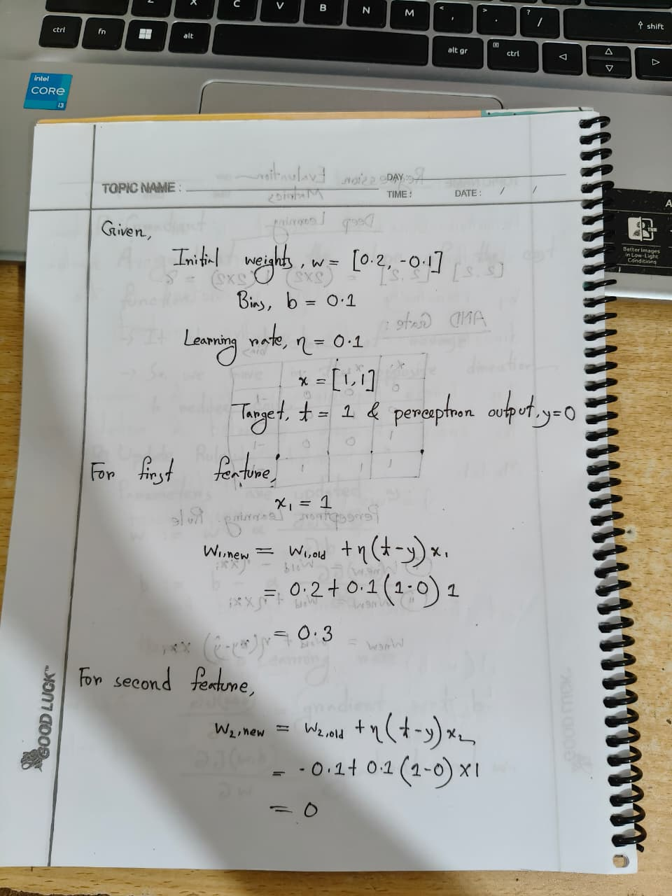
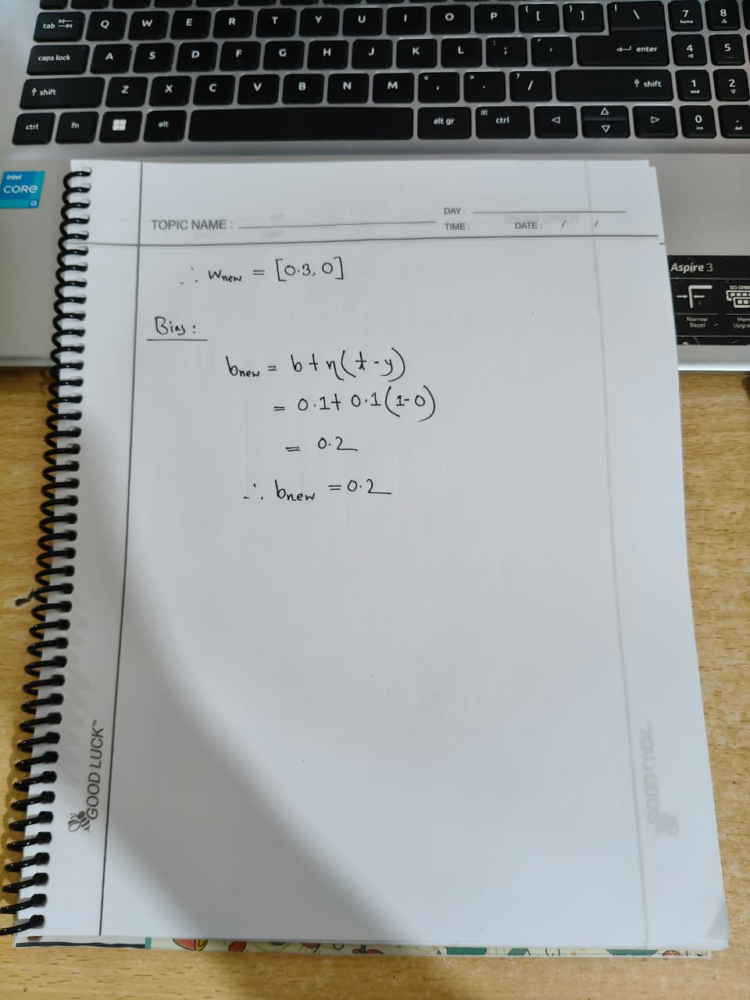

# My Solution to Practice Problems

### Table of Contents

1. Conceptual Questions
   - What is a decision boundary, and how does it relate to classification tasks?
   - How does the bias term affect the position of the decision boundary?
   - Example: how changing weights affects the orientation of the decision boundary
   - Why is it important to visualize the decision boundary when training a model?
2. Calculation Problems
   - Perceptron weight and bias update for a single training example

---

## Conceptual Questions

### 1. What is a decision boundary, and how does it relate to classification tasks?

In a classification task, a model's job is to separate the input (feature) space into regions that correspond to different classes. The **decision boundary** is the surface in that feature space where the model switches from predicting one class to predicting another.

For a linear model such as a single perceptron, this boundary is a hyperplane — a straight line in 2D, a plane in 3D, and so on. It is defined by the equation:

```
w1*x1 + w2*x2 + ... + wn*xn + b = 0
```

Every point that satisfies this equation lies exactly on the boundary. Points on one side get classified as one class, and points on the other side get classified as the other class. So the decision boundary is essentially the geometric picture of what the model has "learned" — it tells us, visually, how the model partitions the input space into class regions.

### 2. How does the bias term affect the position of the decision boundary?

The weights and the bias work together to determine where the decision boundary sits in feature space, but they play different roles:

- The **weights** control the orientation (slope/tilt) of the boundary.
- The **bias** controls how far the boundary is shifted away from the origin, without changing its orientation.

To see this clearly, keep the weights fixed and look at how the boundary is defined:

- If `x1 = 0`, the boundary crosses the x2-axis at the point `(0, -b/w2)`.
- If `x2 = 0`, the boundary crosses the x1-axis at the point `(-b/w1, 0)`.

So with the weights held constant, increasing `|b|` pushes these intercepts further from the origin (moving the whole line outward), while decreasing `|b|` pulls the boundary back toward the origin. When `b = 0`, the boundary is forced to pass exactly through the origin.

In short: **weights and bias together fix the position of the boundary, but if we hold the weights fixed, the bias alone determines how far the boundary sits from the origin** — it shifts the line without rotating it.

### 3. Explain with an example how changing weights affects the orientation of the decision boundary

To illustrate this, consider a single training example:

```
x = [1, 1],   target t = 1
```

Starting weights and bias:

```
w = [0.2, -0.1],   b = 0.1
```

Given the current weights and bias, the old decision boundary (black line) has the model predicting the **wrong** class for our example `E = (1, 1)` — `E` falls inside the "0" region even though its true label is 1.

Applying the perceptron learning rule one weight at a time shows how each individual weight change rotates the line:

**Step 1 — update w1 only** (bias and w2 unchanged):
The boundary rotates so that it swings closer to the misclassified point `E`. Because only w1 changed, the x2-intercept (`-b/w2`) stays exactly where it was, but the x1-intercept (`-b/w1`) shifts, tilting the line.

**Step 2 — update w2 as well** (with the new w1, old bias):
The line rotates further, now moving in from the other direction as w2 changes. This time the x1-intercept stays the same as the previous step, but the x2-intercept changes, since w2 no longer has its original value.

**Step 3 — update the bias** (with both new weights):
Now the line simply slides, without changing its slope, since only b changed this time.

The overall pattern is: **changing a single weight rotates the boundary line around one of its axis-intercepts** (the intercept tied to the weight that stayed fixed), while **changing the bias translates the line without rotating it**. Each individual update nudges the boundary a little closer to correctly separating the misclassified example, and after enough updates the point `E` ends up on the correct side of the line.

### 4. Why is it important to visualize the decision boundary when training a model?

Visualizing the decision boundary while training gives an intuitive, geometric way to understand what the model is actually doing, rather than only tracking abstract numbers like loss or accuracy:

- It helps confirm that the boundary is moving in the right direction — for example, toward correctly separating a misclassified point rather than away from it.
- It can reveal bugs, such as an incorrectly implemented update rule, if the boundary moves in an unexpected or nonsensical way.
- It builds intuition for how weights and bias jointly control the line's orientation and position, which is much harder to grasp from equations alone.
- It can help decide when to stop training or whether more training epochs are needed, by observing whether the boundary is still shifting meaningfully or has stabilized around a good separation of classes.

In short, visualizing the boundary turns an abstract optimization process into something we can inspect and reason about directly.

---

## Calculation Problems

### Weight Update — Perceptron Learning Rule

A perceptron has:

- Initial weights: `w = [0.2, -0.1]`
- Bias: `b = 0.1`
- Learning rate: `η = 0.1`

Training example:

- `x = [1, 1]`
- Target `t = 1`
- Perceptron output `y = 0`

**Update rule:**

```
w_new = w + η * (t - y) * x
b_new = b + η * (t - y)
```

Worked solution:





---

*Note: Images referenced in this document (decision boundary plots for the old, maroon, violet, and orange boundaries) are included alongside this file in the same folder.*
